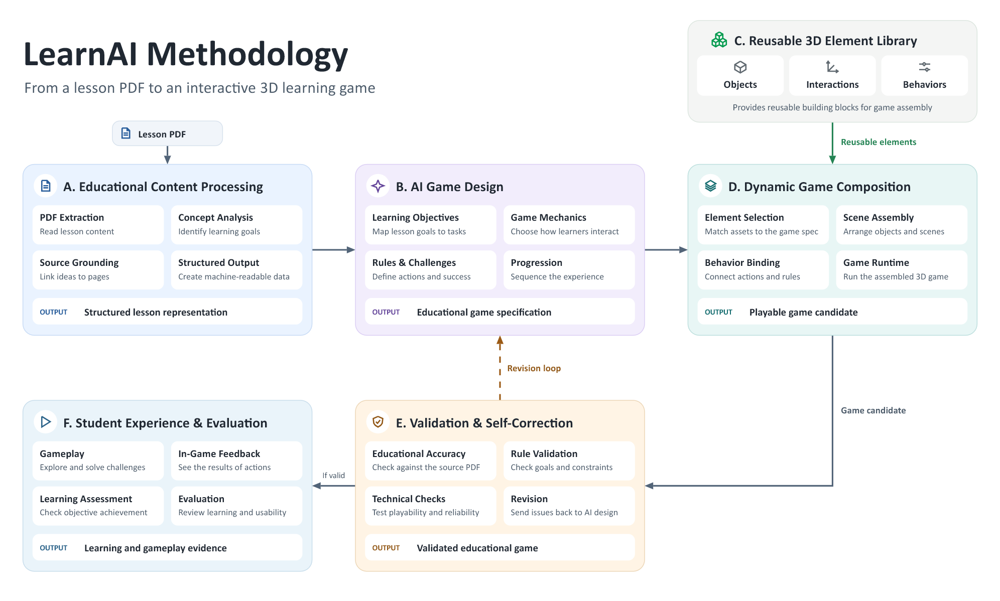

# PDF-to-game methodology

The project methodology starts with a lesson PDF and ends with a playable learning activity and evidence from evaluation. The diagrams describe proposed behavior.

- [Methodology graph](learnai-methodology.drawio) covers content processing, game design, the reusable 3D element library, game composition, validation and revision, and student evaluation.
- [System design](pdf-to-game-diagrams.drawio) has three pages covering system architecture, the PDF-to-game pipeline, and the student activity workflow.
- [Seminar outline](../presentations/seminar-draft.md) documents the first demo and its acceptance checks.

Open either source in diagrams.net to edit individual shapes and connections. The methodology graph describes the broader design, including dynamic scene composition and a reusable element library. The seminar draft narrows the first milestone to a fixed lab that loads a different validated mission for each lesson.

For the demo, extract text with page numbers, identify the learning objective, and generate a mission with answers, feedback, and source evidence. Validate the mission structure and check the cited pages before treating its answers as grounded. Run a browser playthrough to check gameplay. Record any future learning assessment separately.
